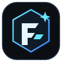

  

<h1 align="center">Pratham Forge Labs</h1>

<strong>ForgeOS / Personal Engineering Workspace</strong> 
Engineer. Experiment. Evolve.

  <picture>
    <source media="(prefers-reduced-motion: reduce)" srcset="assets/forgeos-hero-static.svg" />
    
  </picture>

<a href="assets/forgeos-hero-static.svg">View the static hero</a> · Motion is subtle and respects reduced-motion preferences.

  <a href="https://prathamforgelab.github.io/Portfolio/">Portfolio</a> ·
  <a href="https://github.com/prathamforgelab">GitHub</a> ·
  <a href="https://www.linkedin.com/in/pratham-gupta-ai-engineer">LinkedIn</a> ·
  <a href="mailto:2k24.csai1c.2410591@gmail.com">Email</a>

<strong>AI Engineer · Software Engineer</strong> 
B.Tech student at PSIT Kanpur

---

## 01 / About

I’m Pratham Gupta. I build practical AI systems and software, from reproducible LLM evaluation and cloud decision-support prototypes to voice interfaces and research tools. My work connects careful problem framing, backend engineering, data, and useful interfaces.

**ForgeOS** is the visual identity for this engineering workspace: a place to explore ideas, measure them with evidence, and turn them into working systems.

## 02 / Building & exploring

- **LLM evaluation:** testing prompts and models with measurable quality, latency, cost, and regression signals.
- **Cloud systems:** exploring telemetry, forecasting, and cost- and carbon-aware recommendations across AWS, Azure, and Google Cloud.
- **Applied AI interfaces:** building voice-first and full-stack tools that make complex systems easier to use.

The project notes below stick to the scope documented in each public repository.

## 03 / Selected builds

### [LLM Evaluation Lab](https://github.com/prathamforgelab/LLM-Evaluation-Lab)

A reproducible evaluation framework for comparing LLM prompts and models across accuracy, groundedness, latency, and cost, with a CLI, FastAPI service, React interface, and Python SDK.

`Python` · `FastAPI` · `React` · `Vite`

### [GreenMind AI](https://github.com/Pratham-stack-coder/GreenMind-AI)

An early-stage cloud optimization prototype that explores telemetry, forecasting, and cost- and carbon-aware recommendations across AWS, Azure, and Google Cloud.

`Python` · `FastAPI` · `React` · `TypeScript` · `scikit-learn` · `LangGraph` · `Docker Compose`

### [Industrial Failure Mechanism Discovery](https://github.com/Pratham-stack-coder/industrial-failure-mechanism-discovery)

A team research project (team of six) that discovers and ranks candidate industrial failure explanations from heterogeneous temporal data, with an evidence-focused analysis workflow.

`Python` · `FastAPI` · `React` · `TypeScript` · `PostgreSQL`

### [Python Voice AI](https://github.com/Pratham-stack-coder/Python-voice-AI)

A real-time voice-to-voice assistant built with Python and ElevenLabs Conversational AI.

`Python` · `ElevenLabs Conversational AI`

## 04 / Technology map

Technologies documented in my public projects and coding practice:

**AI & backend**

  
  
  
  
  

**Web & interface**

  
  
  

**Cloud & infrastructure**

  
  
  
  
  

**Languages & problem solving**

  
  
  

## 05 / GitHub signal

  

The stats card is generated from public profile data. If it has not appeared yet, <a href="https://github.com/prathamforgelab?tab=overview">view the live GitHub profile and contribution graph</a>.

  <picture>
    <source media="(prefers-color-scheme: dark)" srcset="https://raw.githubusercontent.com/prathamforgelab/prathamforgelab/output/github-contribution-grid-snake-dark.svg" />
    <source media="(prefers-color-scheme: light)" srcset="https://raw.githubusercontent.com/prathamforgelab/prathamforgelab/output/github-contribution-grid-snake.svg" />
    
  </picture>

If the contribution animation is still generating, use the profile's native <a href="https://github.com/prathamforgelab?tab=overview#contributions-calendar">contributions calendar</a>.

## 06 / Find me

  <a href="https://www.linkedin.com/in/pratham-gupta-ai-engineer">LinkedIn</a> ·
  <a href="https://prathamforgelab.github.io/Portfolio/">Portfolio</a> ·
  <a href="https://github.com/prathamforgelab">GitHub</a> ·
  <a href="https://leetcode.com/u/Pratham_stack_coder">LeetCode</a> ·
  <a href="https://www.hackerrank.com/2k24_csai1c_2412">HackerRank</a> ·
  <a href="mailto:2k24.csai1c.2410591@gmail.com">Email</a>

Built with curiosity, measured with care, and forged in public.

